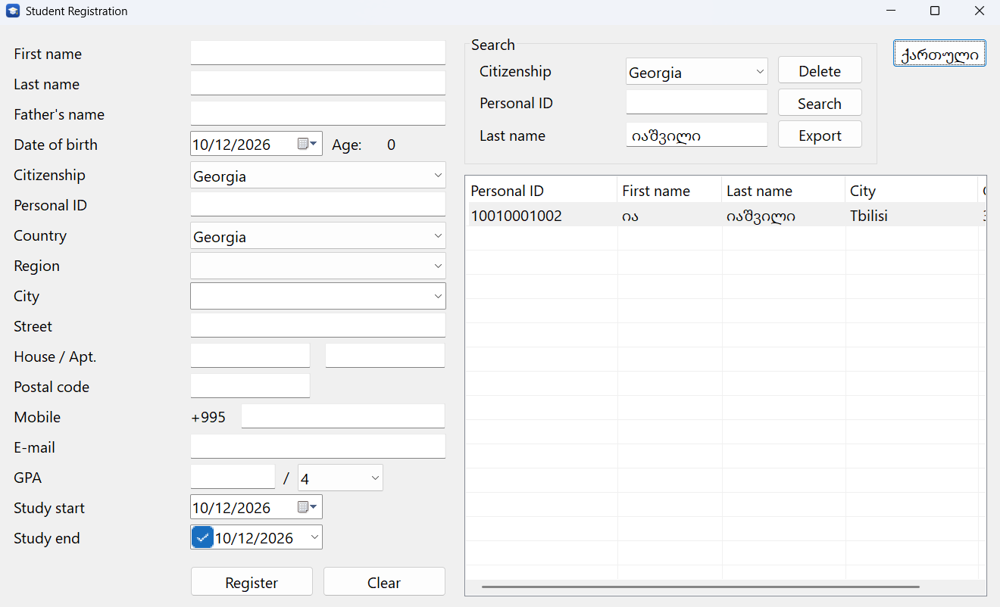
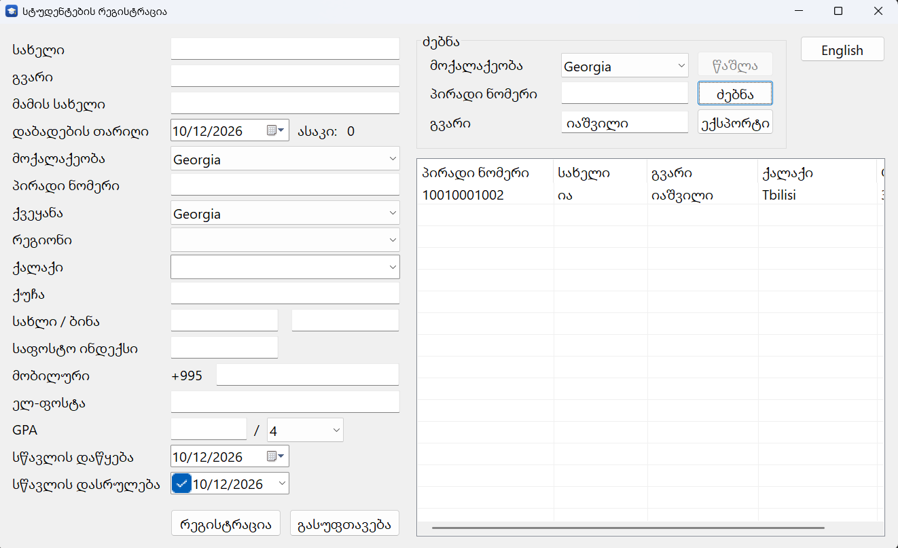

# Student Registration v3

A Windows desktop application for registering students, written in modern **C++20** with the plain **Win32 API** (no frameworks) and **SQLite**.



> The third and last version of a learning series: the same program written in [Assembly (v1)](https://github.com/levanikotorashvili20-spec/StudentRegistration-v1), [C (v2)](https://github.com/levanikotorashvili20-spec/StudentRegistration-v2) and C++ (v3).

## The three versions

| | v1 | v2 | v3 |
|---|---|---|---|
| Language | x86 Assembly (MASM) | C | C++20 |
| Platform | 32-bit | 64-bit | 64-bit |
| SQLite | `sqlite3.dll` | compiled into the exe | `sqlite3.dll` |
| Search by personal ID | ✓ | ✓ | ✓ |
| Search by last name | | ✓ | ✓ |
| CSV export for Excel | | ✓ | ✓ |
| Sorting by column | | | ✓ |
| Remembers language and window | | | ✓ |

All three versions use the same database format, so they can work with the same `students.db`.

## What's new in v3

- **Sorting:** click a column header in the search results to sort by that column, click again to reverse. Text is sorted by the Windows language rules (including the Georgian alphabet), GPA numerically. An arrow in the header shows the current order.
- **Remembered settings:** the language, window size and position, and whether the window was maximized are saved in `data\parametrebi.ini` and restored on the next start. If the window was on a monitor that is no longer connected, it opens in the default position.
- **Safer code:** SQLite is wrapped in C++ classes that close statements and databases automatically, texts are `std::wstring` instead of fixed buffers, and the order of the interface texts is checked at compile time.

## Features

- Register, search, view, edit and delete students
- Search by citizenship and personal ID, or by the beginning of the last name, instant even with **1,000,000 students** in the database
- Export search results with full student data to a CSV file for Excel
- Cascading Country → Region → City lists: 250 countries, 4,000+ regions, 150,000+ cities
- Phone country code filled in automatically from the selected country
- Bilingual interface (Georgian / English), switchable while the program runs
- Input validation: Georgian 11-digit personal ID, e-mail format, GPA within its grading scale, dates
- Resizable window, High-DPI aware, keyboard friendly (Tab, Enter to search, Delete to remove)
- Right-click menu on search results (Open / Delete)

## Download and run

1. Download the latest `.zip` from [Releases](../../releases)
2. Extract the **whole folder** (right-click → Extract All) and run `StudentRegistration v3.exe`

No installation needed. Requires Windows 10 or 11 (64-bit). The students database (`data\students.db`) is created automatically on first run.

> Keep `StudentRegistration v3.exe`, `sqlite3.dll` and the `data` folder together. To start the program from the desktop, create a shortcut (right-click the exe → Send to → Desktop) instead of moving the exe.

## Build from source

Requirements: Visual Studio 2022 or newer with the **Desktop development with C++** workload.

1. Clone the repository and open `StudentRegistration v3.slnx`
2. Select the **x64** platform and build

Only `src\main.cpp` is compiled; all other source files are pulled in with `#include`. The project uses the C++20 standard and the `/utf-8` compiler option (the source files contain Georgian text). `lib\` contains the 64-bit `sqlite3.dll` and its import library; a post-build step copies the DLL next to the exe.

### Countries database (`data\geo.db`)

`geo.db` is generated from the [countries-states-cities-database](https://github.com/dr5hn/countries-states-cities-database) project:

1. Download `sqlite-world.sqlite3.gz` from that project's Releases and extract it to `data\world.sqlite3`
2. Download the SQLite command-line tools (`sqlite3.exe`) from [sqlite.org](https://sqlite.org/download.html) into `tools\`
3. In the `tools` folder run:
   ```
   .\sqlite3.exe ..\data\geo.db ".read make_geo.sql"
   ```

### Test data (optional)

Generates 1,000,000 fictional students:

```
.\sqlite3.exe ..\data\students.db ".read gen_students.sql"
```

**Warning:** this recreates the `students` table, so existing records are deleted.

## Project structure

```
src\           C++ source: only main.cpp is compiled, everything else is included
lib\           SQLite 64-bit (sqlite3.dll, sqlite3.def, sqlite3.lib)
tools\         SQL scripts: geo.db preparation and the test data generator
res\           Application icon
docs\          Screenshots
data\          Databases and settings (not stored in the repository)
app.rc         Icon and version information
```

How the program is organized: [ARCHITECTURE.md](ARCHITECTURE.md)

## Note

This is an educational and portfolio project. It is not intended for storing real personal data: the database is not encrypted and there is no user authentication.

## Licenses

- Source code: [MIT](LICENSE), © 2026 Levan Kotorashvili
- [SQLite](https://sqlite.org) (`lib\sqlite3.dll`, `src\sqlite3.h`): public domain
- Countries, regions and cities: [countries-states-cities-database](https://github.com/dr5hn/countries-states-cities-database) by dr5hn, licensed under [ODbL-1.0](https://opendatacommons.org/licenses/odbl/1-0/). `geo.db` is derived from it and is distributed under the same license.

---

## ქართულად

სტუდენტების რეგისტრაციის Windows-ის პროგრამა, დაწერილი C++20-ზე (Win32 API), SQLite ბაზით. ეს სერიის მესამე, ბოლო ვერსიაა: იგივე პროგრამა დაწერილია [ასემბლერზე (v1)](https://github.com/levanikotorashvili20-spec/StudentRegistration-v1) და [C-ზე (v2)](https://github.com/levanikotorashvili20-spec/StudentRegistration-v2).



**v3-ში ახალი:** შედეგების დალაგება სვეტის სათაურზე დაჭერით; პროგრამას ახსოვს ენა, ფანჯრის ზომა და ადგილი.

**შესაძლებლობები:** სტუდენტის რეგისტრაცია, ძებნა (პირადი ნომრით ან გვარით), ნახვა, რედაქტირება და წაშლა; შედეგების ექსპორტი Excel-ისთვის; ქვეყანა → რეგიონი → ქალაქის სიები; ქართული და ინგლისური ინტერფეისი; ველების შემოწმება.

**გაშვება:** [Releases](../../releases)-დან ჩამოტვირთე zip, ამოიღე **მთელი საქაღალდე** (მარჯვენა ღილაკი → Extract All) და გაუშვი `StudentRegistration v3.exe`. ინსტალაცია არ სჭირდება. exe, `sqlite3.dll` და `data` საქაღალდე ერთად უნდა იყოს.

ეს სასწავლო პროექტია და რეალური პერსონალური მონაცემების შესანახად არ არის განკუთვნილი.
